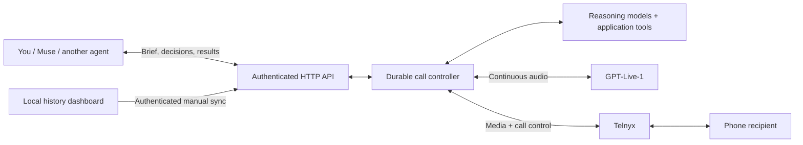

# Muse Calling Assistant

Give your AI assistant a phone—with its own fast voice agent, real keypad navigation, and a way to ask you or Muse for help during a call.

Self-hosted TypeScript service using **OpenAI GPT-Live-1 + Telnyx + Cloudflare Workers**. Bring your own accounts and API keys. Use it directly, connect Meta Muse over HTTPS, or use the included MCP adapter with another agent. This is an independent project, not an official Meta, OpenAI, or Telnyx product.

**[Set it up →](docs/QUICKSTART.md)** · **[Connect Muse →](docs/MUSE.md)** · **[How it works →](docs/SYSTEM.md)** · **[Build your own from scratch →](prompts/BUILD-FROM-SCRATCH.md)**

## What you get

- Full-duplex telephone conversation: listening, speaking, interruptions, and clarification through GPT-Live-1.
- Autonomous backend reasoning for facts, calculations, menu choices, approved commitments, and hangup. Muse is outside the ordinary turn-by-turn conversation path.
- Live consultation: the caller can ask its originating agent or owner a question, wait within a deadline, and continue only under an authorized answer or fallback.
- Real IVR keypad commands, automatic menu handling, exact shareable numeric entry, and agent intervention through the same API.
- Rich call briefs, scoped revocable keys, durable events, idempotency, spending reservations, and one concurrent call.
- Local history dashboard with searchable transcripts and playback of available recordings; the dashboard itself stays on your computer.
- Hosted control console, OpenAPI, typed TypeScript client, and a local stdio MCP server.



## Start with a free local simulation

Requires Node.js 22.12+ and npm. macOS and Linux are the primary development targets; Windows users can use WSL.

```sh
git clone https://github.com/intenex/muse-calling-assistant.git
cd muse-calling-assistant
npm ci
npm run setup
# Keep the placeholder URL and leave provider fields blank for a local demo.
npm run dev
```

Open `http://localhost:8787`, sign in with your generated `OWNER_API_KEY` from `.dev.vars`, and run a simulation. In a second terminal:

```sh
CALLING_API_URL=http://127.0.0.1:8787 npm run test:ivr
```

This two-stage keypad test uses **no paid model or carrier**. It writes only private local test evidence. To run a new fixture later, remove its `.local/ivr-smoke-intent.json` only after the previous simulation has finished; otherwise the same command resumes/replays the same call.

## Enable your own phone service

You need an OpenAI project with access to the configured models, a Telnyx account that permits outbound calling, a Telnyx number and Voice API application, and a Cloudflare account with available Workers/Durable Objects allowance. Two API keys alone cannot provision a usable telephone line.

The [quickstart](docs/QUICKSTART.md) walks through the carrier settings, hidden-input setup, safe first deployment, secret upload, read-only checks, a controlled phone test, and explicit activation. Nothing in installation buys a number, upgrades a plan, enables overages, or makes a real call. Deployments and paid evaluations are manual.

After activation:

```sh
npm run agent:key -- --live
```

Paste the generated `.local/muse-connect.md` into Muse. Enter **only the scoped service key** in Muse's Secure Vault dialog—not the OpenAI key, Telnyx key, or owner key. The [Muse guide](docs/MUSE.md) includes the transport contract, polling behavior, IVR rules, credential rotation, and a free integration fixture. Muse versions and permissions differ: the instructions adapt to its actual credential helper rather than assuming a universal plug-in installer.

## Cost and defaults

The application defaults to simulation, a $50 monthly ceiling, $5 per call, $1 backend allowance per call, one concurrent call, 45 minutes maximum per call, and 90 connected minutes per day. Ordinary supported US personal and business numbers are allowed; agent credentials can narrow that further. There is no automatic redial.

GPT-Live is currently $0.05 per active session minute, including silence and hold time; backend models and telephony are extra. [OpenAI pricing](https://developers.openai.com/api/docs/models/gpt-live-1). The code reserves conservatively and retains unresolved reservations. Its ledger is **not an invoice**. Read [cost controls and estimates](docs/COSTS.md) before activating.

New call briefs default to recording on; set `recording: "off"` to disable it. Recording adds carrier charges. The transport adds no opening speech or beep; caller instructions and `requiredDisclosures` control the actual conversation. Configure recording, identity, authorization, and required disclosures for your use before making real calls. Direct questions about automation are answered truthfully.

## Scope and evidence

This is a working personal-use implementation, not a managed calling platform or a guarantee of successful calls. It currently supports US routes, one owner/account, one concurrent call, and English IVR parsing. There is no inbound receptionist, batch campaign dialer, arbitrary external-tool execution, or universal Muse wakeup webhook.

The source system has been exercised with real calls and Muse integration. The two-stage Muse keypad simulation passed; actual telephone keypad readback and the latest recording path remain unverified in the release evidence. This public export has its own local checks, recorded in [verification](docs/VERIFICATION.md). Private transcripts, recordings, account identifiers, original deployment URLs, and historical Git commits are excluded.

## Documentation

| Guide | Contents |
|---|---|
| [Quickstart](docs/QUICKSTART.md) | Accounts, keys, deployment, activation, first call |
| [System writeup](docs/SYSTEM.md) | Architecture, audio, reasoning, authority, durability, tradeoffs |
| [API](docs/API.md) | Briefs, endpoints, decisions, IVR, TypeScript and MCP |
| [Muse](docs/MUSE.md) | Copy-and-paste onboarding and active-task supervision |
| [Local dashboard](dashboard/README.md) | History, transcript retention, recording playback/import |
| [Operations](docs/OPERATIONS.md) | Deployment, key rotation, kill switch, recovery, troubleshooting |
| [Costs](docs/COSTS.md) | Budget math, bounded work, free-tier headroom |
| [Verification](docs/VERIFICATION.md) | Tests, evidence boundaries, acceptance scenarios |
| [From-scratch prompt](prompts/BUILD-FROM-SCRATCH.md) | Complete implementation brief for your own coding LLM |

MIT licensed. Contributions: [CONTRIBUTING.md](CONTRIBUTING.md). Security: [SECURITY.md](SECURITY.md).
